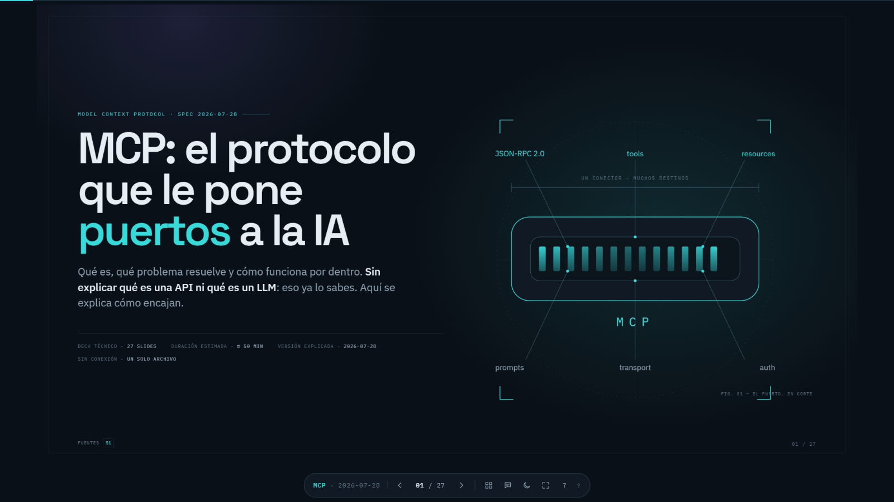
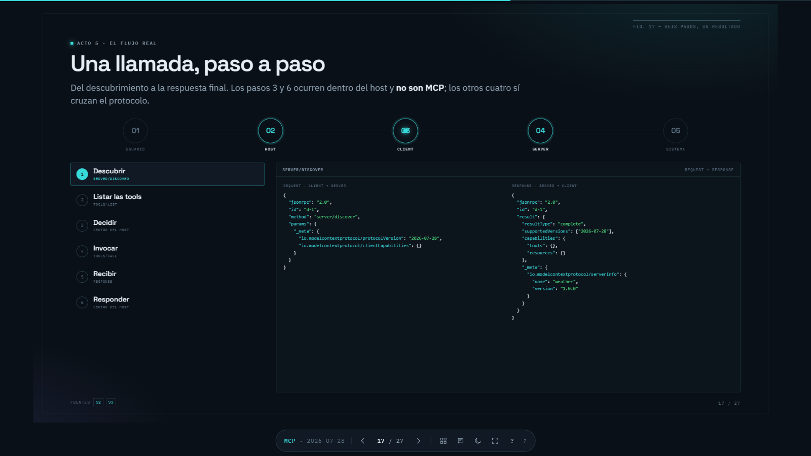

# MCP — el protocolo que le pone puertos a la IA

Una presentación en **HTML que se comporta como un PPT**: un deck de diapositivas navegable, animado y autocontenido, hecho para explicar **qué es MCP (Model Context Protocol)** de la forma más fácil e intuitiva posible.

No es un artículo ni una colección de apuntes: es una presentación real, con portada, recorrido, diagramas, flujos, notas del presentador y cierre. La idea es que cualquiera pueda **abrirla, avanzar con las flechas y entender MCP sin perderse**.

> Versión del protocolo explicada: **2026-07-28**. El deck señala explícitamente qué cambió respecto a versiones anteriores, porque la mayor parte del material que circula en internet describe la versión antigua y eso es la principal fuente de confusión.

---

## ¿Qué es esto?

Un **solo archivo HTML** (`dist/index.html`) que:

- Se abre con **doble clic**, sin servidor, sin instalar nada y **sin conexión a internet**.
- Funciona como un **PowerPoint**: flechas para avanzar y retroceder, contador de slides, barra de progreso, vista general y pantalla completa.
- Incluye **28 slides** con diagramas SVG, ejemplos de código y explicaciones paso a paso.
- Trae **notas del presentador** para quien lo exponga.
- Tiene **tema oscuro y tema claro**, y una versión **imprimible** (una slide por página, lista para exportar a PDF).
- Pesa poco y no descarga nada en tiempo de ejecución: las fuentes van embebidas.

Es útil tanto para **estudiar MCP por tu cuenta** como para **darlo en clase, en una charla o dentro de una empresa**.

---

## Cómo se ve





---

## Cómo verlo

### Opción 1: abrir la versión online (lo más rápido)

**https://devjuanp.github.io/mcp/**

Se puede compartir tal cual: no requiere instalación y funciona en cualquier navegador. Para saltar a una slide concreta, añade `#/17` a la URL.

### Opción 2: abrir el archivo ya compilado

Abre `dist/index.html` en tu navegador. Listo. Funciona sin servidor y sin conexión.

### Opción 3: compilarlo tú mismo

Requiere **Node.js 20 o superior**. No hay dependencias que instalar.

```bash
npm run build     # genera dist/index.html
npm run watch     # recompila al guardar cambios en src/
npm run serve     # compila y levanta un servidor local
```

---

## Controles

| Acción | Tecla |
|---|---|
| Siguiente | `→` `↓` `Espacio` `RePág` |
| Anterior | `←` `↑` `AvPág` |
| Primera / última slide | `Inicio` / `Fin` |
| Vista general de slides | `O` |
| Notas del presentador | `N` |
| Cambiar tema (oscuro / claro) | `T` |
| Pantalla completa | `F` |
| Ver atajos | `?` |
| Cerrar un panel | `Esc` |
| Saltar a una slide concreta | `#/17` en la URL |

> Para exportar a PDF: `Ctrl/Cmd + P` y elige "Guardar como PDF". El CSS de impresión ya deja una slide por página.

---

## Qué se explica

El deck está pensado para alguien con base técnica (sabe qué es un LLM, una API REST, un microservicio o un API Gateway) que todavía no entiende MCP. Por eso no explica lo básico: explica **cómo encaja todo**.

Recorrido aproximado (≈ 50 min):

1. **El problema** — qué sabe y qué no sabe un LLM, function calling y el muro N×M.
2. **La idea** — MCP como "USB-C para la IA", y en qué se diferencia de una API REST.
3. **La arquitectura** — Host, Client y Server; capas; Tools, Resources y Prompts.
4. **El protocolo** — JSON-RPC 2.0, tipos de mensaje, transports, statelessness y el ciclo completo de una llamada.
5. **La realidad** — riesgos, límites, relación con API Gateway, gobernanza, versiones, ecosistema y código.
6. **Cierre** — resumen y fuentes primarias.

Todo dato técnico está referenciado a las fuentes oficiales de MCP y a los anuncios de Anthropic; la última slide las lista.

---

## Estructura del proyecto

```text
.
├─ .github/workflows/         # deploy automático a GitHub Pages
├─ src/
│  ├─ index.template.html    # plantilla del deck
│  ├─ slides/                # 28 slides, un archivo por diapositiva
│  ├─ scripts/
│  │  ├─ deck.js             # navegación, overlays, tema, atajos
│  │  └─ diagrams.js         # diagramas interactivos por pasos
│  └─ styles/                # tokens, deck, slides y estilos de impresión
├─ assets/fonts/             # fuentes .woff2 (se embeben en el build)
├─ docs/                     # plan de implementación e imágenes del README
├─ qa/                       # capturas locales de QA (ignorada por git)
├─ build.mjs                 # ensambla todo en un único HTML
└─ dist/index.html           # resultado final, autocontenido
```

Para editar contenido, toca el archivo de la slide correspondiente en `src/slides/` y vuelve a compilar. El build valida que existan exactamente 28 slides, así que si agregas o quitas una, ajusta el número en `build.mjs`.

---

## Deploy

El sitio vive en **GitHub Pages** y se publica con el workflow [`.github/workflows/deploy.yml`](.github/workflows/deploy.yml): en cada push a `main` se ejecuta `npm run build` y se sube `dist/` como artefacto estático. No hay servidor, secretos ni pasos manuales después del primero.

- La primera vez hay que activar **Settings → Pages → Source: GitHub Actions** en el repo.
- Si el `dist/index.html` commiteado no coincide con el build, el workflow deja un aviso pero no bloquea la publicación (el artefacto siempre se regenera).

---

## Estado

Proyecto en mantenimiento activo. Cada push a `main` compila el deck y lo publica automáticamente en GitHub Pages; el flujo está en [`.github/workflows/deploy.yml`](.github/workflows/deploy.yml).

---

## Licencia

**MIT.** Puedes usar esta presentación libremente: copiarla, modificarla, recortarla, adaptarla y presentarla, incluso con fines comerciales.

Está pensada para que la use **cualquiera**: estudiantes, profesores en clase, empresas en una formación interna, equipos en un onboarding o quien quiera entender MCP. No necesitas pedir permiso. Solo conserva el aviso de copyright y la licencia (ver [`LICENSE`](./LICENSE)).

Si te sirve, se agradece la atribución, pero no es obligatoria.
